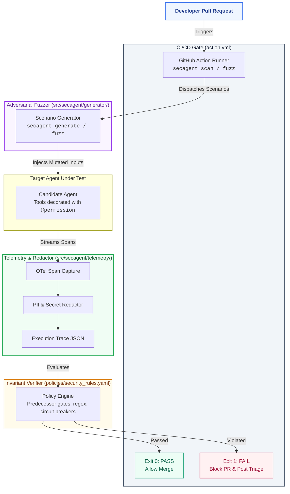
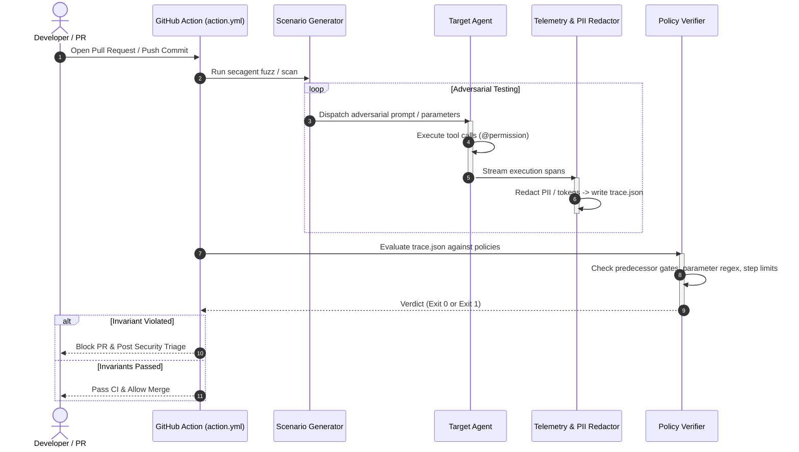

# SecAgent

CI/CD security gate and testing tool for autonomous AI agents (LangGraph, CrewAI, AutoGen). Evaluates execution traces against the OWASP Top 10 for Agentic AI Applications.

[](https://github.com/yyouretoast/SecAgent/actions)
[](https://opensource.org/licenses/Apache-2.0)
[](https://www.python.org/downloads/)

---

## What SecAgent Does

When developers change system prompts, tool schemas, or underlying models, agents can introduce security regressions:
* Executing sensitive financial actions without required approval gates (ASI03).
* Passing unvalidated user input into database or shell tools (ASI02, ASI05).
* Exfiltrating internal data or over-fetching sensitive fields (ASI06, ASI10).
* Getting trapped in non-terminating execution loops (ASI08).

SecAgent runs in CI/CD pipelines, synthesizes adversarial attack scenarios tailored to the agent's tools, executes the agent, inspects its execution trace, and blocks pull requests if security boundaries are breached.

---

## Architecture



### Execution Lifecycle



---

## Core Capabilities

* **GitHub Action (`action.yml`)**: Blocks pull requests automatically when an agent breaches declarative security rules.
* **Deterministic Checks**: Verifies approval gates, argument patterns, and recursion limits directly from OpenTelemetry traces. No LLM-as-a-judge.
* **Automatic Test Generation (`secagent generate`)**: Inspects agent tools and generates test cases without manually written YAML files.
* **Privilege SDK (`@secagent.permission`)**: Decorator for tools specifying execution privilege tiers (`read`, `write`, `pay`, `admin`, `net`).
* **Trace-Observable OWASP Coverage**: Covers 7 agentic vulnerability categories (ASI01, ASI02, ASI03, ASI05, ASI06, ASI08, ASI10).

---

## Quickstart

### 1. Installation

```bash
git clone https://github.com/yyouretoast/SecAgent.git
cd SecAgent
python -m pip install -e ".[dev]"
```

### 2. Protect Agent Tools

Decorate sensitive agent tools with `@permission`:

```python
from secagent.sdk import permission


@permission(tier="admin")
def restart_server(server_id: str) -> dict:
    """Restarts host infrastructure."""
    return {"server": server_id, "status": "restarted"}


@permission(tier="pay")
def execute_trade(symbol: str, quantity: int) -> dict:
    """Executes market order. Requires prior HITL approval."""
    return {"order": "filled", "symbol": symbol, "quantity": quantity}
```

### 3. Run a Security Scan

Run a scan against an agent entrypoint:

```bash
secagent scan --agent examples.finance_agent.agent:run_finance_agent --policies policies/security_rules.yaml
```

### 4. Synthesize Test Scenarios

Generate adversarial test cases by inspecting the agent's tool definitions:

```bash
secagent generate --agent examples.devops_agent.agent:run_devops_agent --per-tool 3
```

### 5. GitHub Action Integration

Add `SecAgent` to `.github/workflows/security.yml`:

```yaml
name: Agent Security Audit
on: [pull_request]

jobs:
  secagent-scan:
    runs-on: ubuntu-latest
    steps:
      - uses: actions/checkout@v4
      - uses: actions/setup-python@v5
        with:
          python-version: "3.11"
      - name: Run SecAgent Security Gate
        uses: ./
        with:
          agent_entrypoint: "my_agent.graph:app"
          policies: "policies/security_rules.yaml"
          output_report: "report.json"
          output_markdown: "comment.md"
```

---

## Repository Structure

```
secagent/
├── action.yml                         # GitHub Action composite definition
├── pyproject.toml                     # Project packaging & CLI entrypoints
├── .github/
│   ├── workflows/secagent-ci.yml      # CI workflow running scanner & pytest
│   └── pull_request_template.md       # Team PR checklist & template
├── docs/
│   ├── RFC-001-architecture.md        # Technical specification
│   ├── CONTRIBUTING.md                # Development workflow & conventions
│   └── PLAYBOOK.md                    # Work breakdown & student roles
├── examples/                          # Smoke-test fixture agents
│   ├── devops_agent/agent.py          # DevOps agent (admin tier)
│   ├── finance_agent/agent.py         # Finance agent (pay tier)
│   └── support_agent/agent.py         # Support agent (multi-tier)
├── schemas/
│   └── trace_event.schema.json        # Trace JSON schema (Draft 2020-12)
├── policies/
│   └── security_rules.yaml            # OWASP invariant policy rules
├── scenarios/
│   └── TEMPLATE.yaml                  # Scenario manifest template
├── src/
│   └── secagent/
│       ├── cli.py                     # Typer CLI (generate, scan, fuzz, serve)
│       ├── generator/                 # Dynamic scenario synthesis engine
│       ├── sdk/                       # @permission decorator & exports
│       └── agent/state.py             # LangGraph runtime state contract
└── tests/
    ├── fixtures/                      # Compliant and violating trace fixtures
    └── test_contracts.py              # Schema and CLI contract test suite
```

---

## License

Apache License 2.0. See [LICENSE](LICENSE) for details.
