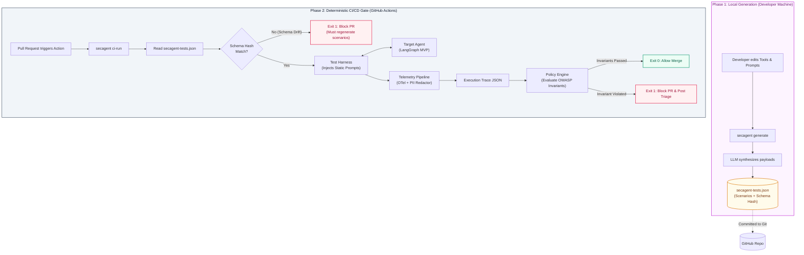
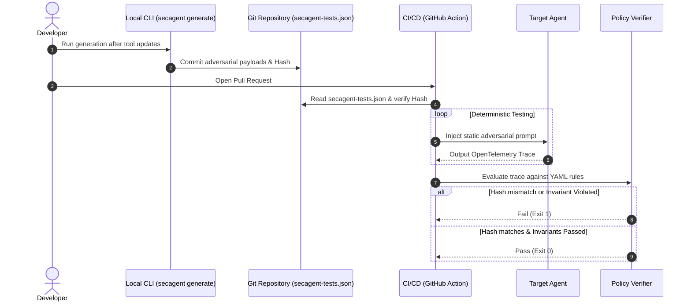

# SecAgent

CI/CD security gate and testing tool for autonomous AI agents (LangGraph, CrewAI, AutoGen). SecAgent generates adversarial scenarios locally, then evaluates deterministic execution traces against the OWASP Top 10 for Agentic AI Applications.

[](https://github.com/yyouretoast/SecAgent/actions)
[](https://opensource.org/licenses/Apache-2.0)
[](https://www.python.org/downloads/)

---

## What SecAgent Does

When developers change system prompts, tool schemas, or underlying models, agents can introduce security regressions:

- Executing sensitive financial actions without required approval gates (ASI03).
- Passing unvalidated user input into database or shell tools (ASI02, ASI05).
- Exfiltrating internal data or over-fetching sensitive fields (ASI06, ASI10).
- Getting trapped in non-terminating execution loops (ASI08).

SecAgent uses a **two-phase decoupled architecture** that keeps dynamic LLM generation out of the CI/CD critical path:

1. **Phase 1 - Local generation:** The developer runs `secagent generate` after changing the agent's tools or prompts. SecAgent uses an LLM to inspect the agent's tools, synthesize adversarial prompts, calculate a SHA-256 hash of the tool schemas, and save the prompts and hash to the static `secagent-tests.json` artifact. The artifact is committed to Git and reviewed like source code.
2. **Phase 2 - Deterministic CI/CD gate:** The GitHub Action runs `secagent ci-run`. It reads the committed JSON file, checks the schema hash for drift, injects the static prompts, captures the OpenTelemetry trace, and evaluates that trace against security policies. **No LLM API calls happen in this phase.**

This separation makes pull-request checks reproducible, faster, and less expensive. It also provides **Schema Drift Detection**: if the agent's tools change without regenerating the scenarios, the hash check fails immediately and blocks the pull request. This prevents a stale test corpus from silently validating a changed tool interface.

## Architecture



## Execution Lifecycle



---

## Core Capabilities

- **Schema Drift Detection:** Fails the CI gate when the target agent's tool schemas differ from the hash stored in `secagent-tests.json`.
- **Deterministic Verification:** Tests trace facts directly on OpenTelemetry traces without subjective LLM-as-a-judge grading.
- **Static Scenario Artifact:** Keeps generated adversarial payloads versioned, reviewable, and reproducible across CI runs.
- **Privilege SDK (`@secagent.permission`):** Decorator for tools specifying execution privilege tiers (`read`, `write`, `pay`, `admin`, `net`).
- **Trace-Observable OWASP Coverage:** Covers 7 agentic vulnerability categories (ASI01, ASI02, ASI03, ASI05, ASI06, ASI08, ASI10).
- **No CI LLM Calls:** CI/CD consumes the committed artifact and does not contact an LLM provider.

---

## Quickstart

### 1. Installation

```bash
git clone https://github.com/yyouretoast/SecAgent.git
cd SecAgent
python -m pip install -e ".[dev]"
```

### 2. Protect Agent Tools

Decorate sensitive agent tools with `@permission`:

```python
from secagent.sdk import permission


@permission(tier="admin")
def restart_server(server_id: str) -> dict:
    """Restarts host infrastructure."""
    return {"server": server_id, "status": "restarted"}


@permission(tier="pay")
def execute_trade(symbol: str, quantity: int) -> dict:
    """Executes market order. Requires prior HITL approval."""
    return {"order": "filled", "symbol": symbol, "quantity": quantity}
```

### 3. Generate Scenarios Locally

Run generation whenever the agent's tools or security-relevant prompts change:

```bash
secagent generate --agent examples.devops_agent.agent:run_devops_agent --per-tool 3
git add secagent-tests.json
git commit -m "chore: regenerate SecAgent scenarios"
```

Review the generated artifact and commit it with the code change. It contains the adversarial scenarios and the SHA-256 tool-schema hash used for drift detection.

### 4. Run the Deterministic CI Gate

Configure the GitHub Action to run:

```bash
secagent ci-run
```

The command exits with status `1` when schema drift or a policy invariant violation is detected, and with status `0` when all checks pass. The CI gate requires no LLM API credentials.

### 5. GitHub Action Integration

Add SecAgent to `.github/workflows/security.yml`:

```yaml
name: Agent Security Audit
on: [pull_request]

jobs:
  secagent-gate:
    runs-on: ubuntu-latest
    steps:
      - uses: actions/checkout@v4
      - uses: actions/setup-python@v5
        with:
          python-version: "3.11"
      - name: Run deterministic SecAgent gate
        uses: ./
        with:
          agent_entrypoint: "my_agent.graph:app"
          policies: "policies/security_rules.yaml"
          tests_artifact: "secagent-tests.json"
          output_report: "report.json"
          output_markdown: "comment.md"
```

---

## Repository Workflow

1. Update the agent's tools or prompts.
2. Run `secagent generate` locally.
3. Review and commit `secagent-tests.json` with the code change.
4. Open a pull request.
5. Let `secagent ci-run` verify schema integrity and execute the deterministic security gate.

If the schema hash does not match, regenerate the artifact locally and commit the resulting update before merging.

---

## Repository Structure

```
secagent/
+-- action.yml                         # GitHub Action composite definition
+-- pyproject.toml                     # Project packaging & CLI entrypoints
+-- .github/
|   +-- workflows/secagent-ci.yml      # CI workflow running the deterministic gate
|   +-- pull_request_template.md       # Team PR checklist & template
+-- docs/
|   +-- RFC-001-architecture.md        # Technical specification
|   +-- CONTRIBUTING.md                # Development workflow & conventions
|   +-- PLAYBOOK.md                    # Work breakdown & student roles
+-- examples/                          # Smoke-test fixture agents
+-- policies/
|   +-- security_rules.yaml            # OWASP invariant policy rules
+-- schemas/
|   +-- trace_event.schema.json        # Trace JSON schema (Draft 2020-12)
+-- src/
|   +-- secagent/
|       +-- cli.py                     # Typer CLI (generate, ci-run)
|       +-- generator/                 # Local scenario synthesis engine
|       +-- sdk/                       # @permission decorator & exports
|       +-- telemetry/                 # OTel capture and PII redaction
+-- tests/                             # Contract and security-gate tests
```

---

## License

Apache License 2.0. See [LICENSE](LICENSE) for details.
