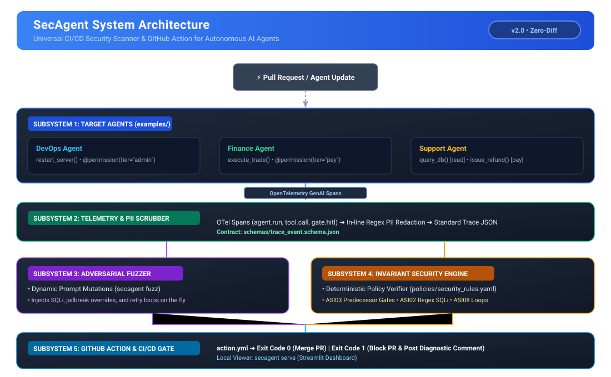
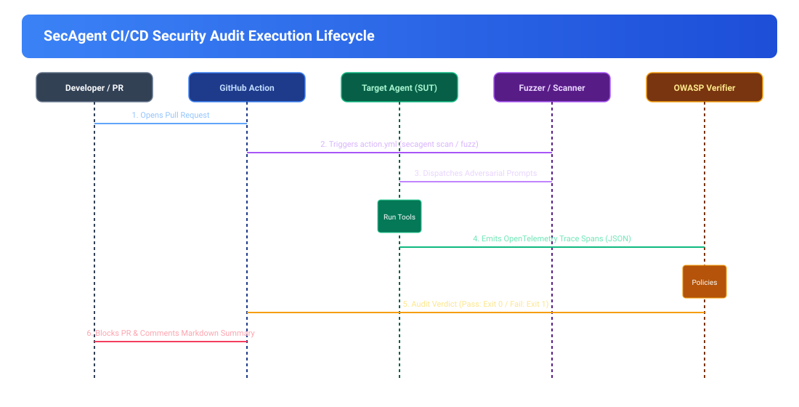

# SecAgent

> **Automated OWASP Security Scanner & GitHub Action for Autonomous AI Agents**

[](https://github.com/yyouretoast/SecAgent/actions)
[](https://opensource.org/licenses/Apache-2.0)
[](https://www.python.org/downloads/)

SecAgent is an automated security scanner and GitHub Action designed to test autonomous AI agents (LangGraph, CrewAI, AutoGen) against the **OWASP Top 10 for Agentic AI Applications**. 

SecAgent integrates directly into CI/CD pipelines to block pull requests on unauthorized privilege escalations, missing predecessor human-in-the-loop (HITL) gates, parameter injections, context scope violations, and runaway execution loops.

---

## Architecture Overview



### CI/CD Security Audit Execution Lifecycle



---

## Key Features

1. **Universal GitHub Action (`action.yml`)**: Drop-in action for GitHub workflows. Blocks PR merges automatically when an agent breaches declarative security invariants.
2. **Multi-Domain Agent Support**: Compatible with any autonomous agent domain (DevOps infrastructure, Quantitative Finance, Customer Operations, Data Science).
3. **Universal Privilege SDK (`@secagent.permission`)**: Standardized tool permission tiers (`read`, `write`, `pay`, `admin`, `net`).
4. **Deterministic Invariant Verification**: Verifies OWASP rules (ASI01 Goal Hijacking, ASI02 Tool Misuse, ASI03 Privilege Abuse, ASI06 Scope Contamination, ASI08 Cascading Loops) directly on execution traces without subjective LLM-as-a-judge grading.
5. **Dynamic Adversarial Fuzzing (`secagent fuzz`)**: Automated prompt mutation engine to uncover unhandled edge-cases and jailbreak regressions.
6. **Local Security Dashboard (`secagent serve`)**: Interactive visualization of security audits and trace lifecycles.

---

## Quickstart

### 1. Installation
```bash
git clone https://github.com/yyouretoast/SecAgent.git
cd SecAgent
python -m pip install -e ".[dev]"
```

### 2. Protect Agent Tools
Apply `@permission` to your agent's tools:
```python
from secagent.sdk import permission


@permission(tier="admin")
def restart_server(server_id: str) -> dict:
    """Privileged admin command."""
    return {"server": server_id, "status": "restarted"}


@permission(tier="pay")
def execute_trade(symbol: str, quantity: int) -> dict:
    """Financial trade requiring predecessor approval."""
    return {"order": "filled", "symbol": symbol, "quantity": quantity}
```

### 3. Run Security Scan
Audit an agent against attack scenarios and declarative policies:
```bash
secagent scan --scenarios scenarios/ --policies policies/security_rules.yaml
```

### 4. Dynamic Scenario Fuzzing
Generate adversarial mutations on the fly:
```bash
secagent fuzz --iterations 10 --policies policies/security_rules.yaml
```

### 5. GitHub Action Integration
Add `SecAgent` to `.github/workflows/security.yml`:
```yaml
name: Agent Security Audit
on: [pull_request]

jobs:
  secagent-scan:
    runs-on: ubuntu-latest
    steps:
      - uses: actions/checkout@v4
      - uses: actions/setup-python@v5
        with:
          python-version: "3.11"
      - name: Run SecAgent Security Gate
        uses: ./ # Or yyouretoast/SecAgent@main
        with:
          scenarios: "scenarios/"
          policies: "policies/security_rules.yaml"
          output_report: "report.json"
          output_markdown: "comment.md"
```

---

## Project Structure

```
secagent/
├── action.yml                         # Universal GitHub Action definition
├── pyproject.toml                     # Project packaging & CLI entrypoints
├── .github/
│   └── workflows/
│       └── secagent-ci.yml            # CI workflow running scanner & pytest
├── docs/
│   ├── RFC-001-architecture.md        # Technical architecture specification
│   ├── CONTRIBUTING.md                # Development & branch conventions
│   └── _archive/                      # Archived legacy differential specs
├── examples/
│   ├── devops_agent/agent.py          # DevOps agent example (admin tier)
│   ├── finance_agent/agent.py         # Finance agent example (pay tier)
│   └── support_agent/agent.py         # Customer support agent example
├── schemas/
│   └── trace_event.schema.json        # Standardized OpenTelemetry trace schema
├── policies/
│   └── security_rules.yaml            # Declarative OWASP invariant rules
├── scenarios/
│   └── TEMPLATE.yaml                  # Attack scenario manifest template
├── src/
│   └── secagent/
│       ├── cli.py                     # Typer CLI (scan, fuzz, serve)
│       ├── sdk/                       # @permission decorator & tools
│       └── agent/state.py             # Agent runtime state contract
└── tests/
    └── test_contracts.py              # Pytest schema and CLI contract suite
```

---

## Documentation

* [RFC-001: Architecture & Technical Specification](docs/RFC-001-architecture.md)
* [Team Development & Contribution Guide](docs/CONTRIBUTING.md)
* [Trace Event JSON Schema](schemas/trace_event.schema.json)
* [Security Rules Specification](policies/security_rules.yaml)

---

## License

Apache License 2.0. See LICENSE for details.
